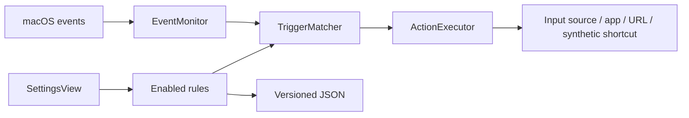

# Architecture

## Layers

`Sources/ShortcutCore` is a Foundation-only library. It contains versioned Codable models (`ShortcutModels.swift`), the deterministic state machine (`TriggerMatcher.swift`), atomic JSON persistence (`ConfigurationStore.swift`), and action validation (`RuleActionValidator.swift`). `Tests/ShortcutCoreTests` exercises this layer without global permissions.

`Tests/MacIntegrationTests` covers application-model persistence, failed-load/save behavior, read-only input-source discovery, unavailable sources, and asynchronous action errors/cancellation. It does not start event taps, request permissions, select an input source, synthesize keys, or launch applications. Global input behavior requires the manual checklist.

`Sources/KeyboardShortcutter` contains macOS integration:

- `KeyboardShortcutterApp`: application lifecycle and SwiftUI menu-bar entry point.
- `AppModel`: settings, permission status, monitoring lifecycle, and coordination.
- `EventMonitor`: passive monitoring or active F-key/Option filtering, physical modifier identification, state recovery, and conversion to core `KeyboardEvent` values.
- `ActionExecutor`: dispatches matched actions to independent implementations. Synthetic events carry an app-specific marker to prevent feedback.
- `InputSourceService`: runtime Text Input Source Services enumeration and selection. Unavailable sources return a visible error. `InputSourceSelecting` allows tests to replace OS selection without changing the user's input source.
- `InputMethodActivationRecovery`: confirms that the focused app applied a switch from an ASCII layout to Apple Japanese Hiragana, and otherwise finishes it with a single Kana key after reselecting ASCII.
- `SystemActionSender`: balanced, tagged volume/playback/brightness auxiliary-control events; injectable posting for tests.
- `FunctionKeyEventFilter`: owns matched F-key down/repeat/up transitions while preserving unassigned and synthetic events.
- `FunctionKeySettingsView`: F1–F20 assignments and a non-overwriting F9/F10 volume preset.
- `SettingsView` and `ShortcutRecorder`: rule editing and local, focused shortcut capture.
- `PreferencesMigration`: one-way migration of the pause preference from the former local bundle ID; never copies unrelated defaults or replaces a saved preference.

The Swift package keeps the two modules separate. The Xcode app target compiles both source directories together, using conditional `canImport(ShortcutCore)` imports. Its synchronized Sources group automatically includes added Swift files.

Build commands use `scripts/swift-env.sh` to select full Xcode for SwiftUI compiler plugins and XCTest. The wrapper respects an explicit `DEVELOPER_DIR`, otherwise uses the selected full Xcode or the standard `/Applications/Xcode.app` installation. It does not alter the machine's `xcode-select` setting.

## Matching and event processing

The tap performs event conversion and inexpensive in-memory matching; OS action execution and UI reporting are deferred outside the event callback. A low-frequency recovery timer checks hardware only when tracked presses remain after keyboard activity has gone quiet. Once all physical keys are released, it clears stale monitor, matcher, and pending-action state left by missed release notifications. It does not turn interrupted presses into actions. Physical modifiers use individual virtual key codes plus device-specific flags; ordinary combinations use logical modifier sets. No event text is extracted.

macOS also sets the function flag for arrow, navigation, and F keys. The adapter and recorder track physical Fn separately so a recorded combination agrees with the key picker. Startup and recovery take a single hardware-state snapshot to avoid treating an already-held key as a fresh tap.

`TriggerMatcher` tracks pressed keys, pressed physical modifiers, and candidates for a modifier-only tap. Any competing key, modifier, or mouse activity invalidates the candidate. A clean release fires once; no duration threshold is imposed. Repeated keyDown events repeat only volume and brightness system actions, after an observed initial press and while the same unique rule/action remains enabled. All other actions fire once per press. Modifier sets for shortcuts must match exactly. Multiple enabled rules with the same trigger are reported as conflicts and suppressed together.

Pause, recording, event-tap interruptions, and session changes reset transient state so an incomplete press cannot become a later tap. The adapter re-enables an OS-disabled tap when appropriate and reports failures. Synthetic shortcut sending waits for physical release, expires after five seconds, and marks emitted events so they cannot recursively match rules.

All input-source actions use the release/focus/cancellation pipeline. Once physical keys are released and the foreground application is unchanged, they select the configured source using `TISSelectInputSource`. Input-source selection itself does not require Accessibility permission; active Option/F-key filtering and actions that post synthetic input still do. A subsequent input-source action cancels an older pending request so it cannot override the new selection. Unit tests inject source selection, hardware state, foreground PID, selection notifications, timers, and event posting; they never alter the real input source or send global keys.

TIS selection alone can leave the focused client's input method inactive while TIS and the menu report the requested source; see [the Karabiner maintainer's report](https://github.com/pqrs-org/Karabiner-Elements/discussions/4095). On macOS 27.0.1 this reproduced with Apple Japanese Hiragana in an AppKit text view and in Chrome: occasionally for a single switch, and most often when Japanese, ASCII, and Japanese were selected in quick succession. A client that applies the switch is followed by further `kTISNotifySelectedKeyboardInputSourceChanged` notifications, within 40 ms when a text field is focused. A stale client leaves only the notification for the app's own selection.

`InputMethodActivationRecovery` uses that signal only for a switch from an ASCII-capable keyboard layout to the Hiragana mode of Apple's Japanese input method. It observes the distributed notification with immediate delivery, because this background app never becomes active. If no further notification arrives within 0.15 s, it reselects the previous layout, waits 0.08 s for the client to apply it, and posts one tagged Kana down/up pair from a private event source. The client's own text-input system then performs the switch. Recovery stops when the frontmost app or selected source changes, secure input is active, a modifier is held, Accessibility is unavailable, monitoring resets, or another source is requested. Repeating the same request joins the running check instead of issuing another rapid TIS change. Other modes, input methods, and languages keep TIS-only behavior.

Kana is never posted while Japanese is selected. The earlier fallback (1.1.2–1.1.4) posted Kana right after the TIS selection, so a stale or active client received it as input: U+0010 on ANSI, U+0020 on JIS, an unhandled mode-switch key, or reconversion of the preceding text. AppKit's default [noResponder(for:)](https://developer.apple.com/documentation/appkit/nsresponder/noresponder(for:)) beeps for an unhandled key-down. Kana alone is not the primary switch either: it never failed to switch in testing, but in Chrome it inserted a space before the preceding ASCII character in about 4% of switches. Recovery confines that exposure to switches TIS failed to apply. Without a focused text field, confirmation can take 160–260 ms, so recovery may run unnecessarily; forced recovery in that state produced neither the alert path nor extra text in AppKit or Chrome. Actual text conversion must still be checked in the target application.

For 1.1.7 build 9, all 146 automated tests passed, along with lint and the Developer ID build. Through the installed app, scripted right-Option taps and left-then-right taps 0.15–0.25 s apart produced Japanese text in 24 of 24 trials in an AppKit test field and 24 of 24 in an isolated Chrome profile; recovery ran twice and succeeded both times. This does not validate every application, IME, keyboard layout, or macOS version.

## F-key and Option filtering

The default mode uses `CGEventTapOptions.listenOnly`, checks `CGPreflightListenEventAccess`, and requires Input Monitoring permission. It never consumes the original shortcut. When an enabled F-key mapping exists or `disableOptionModifiers` is enabled, the monitor uses `defaultTap` and checks `AXIsProcessTrusted` for explicitly granted Accessibility permission. This active mode does not additionally gate on Input Monitoring. A failed permission check or event-tap creation reports monitoring failure; it must not silently fall back to passive mode while claiming Option suppression is active.

For F1–F20, a uniquely matched enabled mapping consumes the original down, all repeats, and its matching release. Unassigned, disabled, conflicting, and differently modified F-key operations pass through. Consumed press ownership is retained across synthetic-event matcher resets. No per-device HID mappings or system function-key preferences are changed. Rule changes reevaluate the event-tap mode; disabling the final F mapping returns to passive mode unless Option suppression still requires an active tap.

The matcher always receives the original physical event. After matching, the active filter consumes physical left/right Option `flagsChanged` events and removes the aggregate Option flag and both device-specific Option bits from forwarded keyboard, mouse, and scroll events. It preserves every other modifier. For Option-affected keyboard events, it reconstructs the event from the physical key code and cleaned flags without reading Unicode text; this avoids forwarding an already translated Option character payload after clearing only the flags. Thus Option + K reaches the foreground app as K while an Option-based trigger can still execute its configured action. Work in the callback is bounded state tracking, flag manipulation, and keyboard-event reconstruction; actions run later.

App-generated shortcuts carry a private marker and bypass both matching and filtering. A deliberately configured Option shortcut therefore retains its Option flags and cannot recursively activate a rule. Pause, quit, and local shortcut recording stop the filter, restoring native Option behavior. Mode changes restart the tap and reset matching state; users should release all keys before changing modes to avoid unmatched transitions in receiving apps.

Suppression applies only while this app has an operational tap. It does not promise to alter boot/login input, protected Secure Keyboard Entry, or direct hardware-state queries. Permissions, downstream modifier state, tap recovery, and native Option behavior must be verified using the manual macOS checklist; pure event tests cannot establish global behavior.

## Persistence

The production bundle ID is `com.foxode.keyboardshortcutter.app`. Before creating `AppModel`, app startup copies `monitoringPaused` from the old `local.keyboardshortcutter.app` defaults domain only if the new domain has no saved value. Configuration JSON stays at `~/Library/Application Support/KeyboardShortcutter/settings.json`; the migration does not move, rewrite, or delete it. macOS permissions and login-item registration require the user to authorize the new app.

`RulesConfiguration` has `schemaVersion: 1`. `ConfigurationStore` validates before atomic writes and checks the version before decoding the body. Missing configuration produces two editable defaults: left Option selects ABC English, and right Option selects Japanese Hiragana. Available input sources are discovered at runtime; ABC is preferred over other English sources. A Japanese source must identify itself as Hiragana in its display name to be proposed automatically; otherwise the user selects it in Settings. New defaults never replace existing saved mappings. Empty saved rule arrays remain empty. Failed reads, unsupported versions, invalid triggers, or duplicate rule IDs do not justify overwriting a file.

`disableOptionModifiers` is an additive Boolean in schema version 1. New configurations default to `false`, and decoding a saved configuration without the field also yields `false`. Persist it through the same atomic write path as mappings; do not replace existing rules when saving this preference.

Actions have a string discriminator so an unknown action kind can survive decoding and be shown as unavailable. The current schema retains the known action fields; `systemAction` is an additive optional raw string, decoded as absent for old settings and retained for unknown future system-action values. Adding other new fields requires an explicit compatibility policy. Unknown trigger kinds fail decoding, preserving the file. Future migrations should explicitly transform old data, retain a backup when needed, and never silently reset user choices.

## Add a trigger

1. Add a Codable case to `ShortcutTrigger`, with a stable representation and display label. Define any schema migration before changing stored data.
2. Extend normalized `KeyboardEvent` only if the new trigger needs additional non-text input data.
3. Add matching state and reset behavior to `TriggerMatcher`; define overlap/conflict behavior.
4. Update the macOS event adapter and Settings editor. Request new permissions only if the new implementation requires them.
5. Add deterministic tests for normal activation, interruption, release, repeat, pause/reset, and conflict cases, then extend the manual checklist.

## Add an action

1. Define a stable `ShortcutAction.kind` and Codable payload fields; document defaults and migration behavior.
2. Add an independent action implementation and register it with `ActionExecutor`.
3. Extend `RuleActionValidator` and the Settings configuration form. Present unavailable resources and execution failures to the user.
4. Test configuration round trips, invalid payloads, unavailable resources, and unknown kinds. Test OS integration manually.

Actions run outside the event callback. Do not introduce shell execution implicitly, store typed content, or perform background networking. Automation that needs additional permissions must explain and request them only when selected.
